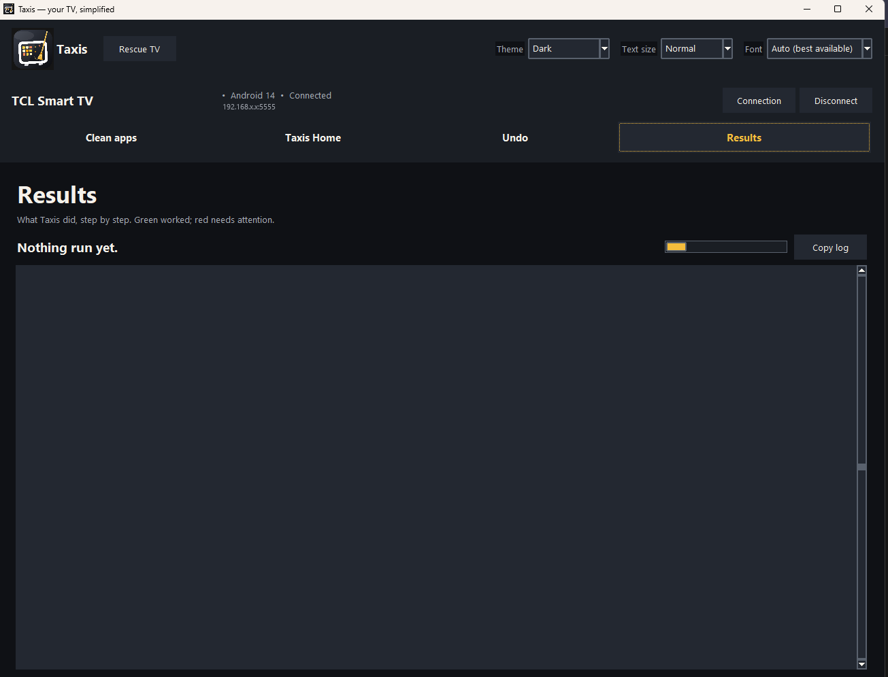

# Taxis

A safe, reversible way to switch off unwanted preinstalled apps on **Android TV, Google TV and Amazon Fire TV**, from your computer over your home network.

- **You choose** which apps to disable. The tool lists what it found and waits for your selection.
- **Nothing is uninstalled.** Apps are only disabled and can be turned back on at any time.
- **Undo is built in.** Every run saves a snapshot and there are three ways to restore.
- No root, no cable, no account.

> Inspired by [Gathin23/cleanyourtv](https://github.com/Gathin23/cleanyourtv). No code was copied. Not affiliated with Amazon, TCL, Google or any TV maker. Use at your own risk.

Taxis is free and has no paid features, advertisements or subscriptions.
If it helps you, an optional tip is welcome at
[Buy Me a Coffee](https://buymeacoffee.com/soranagi).



---

## Download for Windows

Download `Taxis.exe` from the
[latest GitHub release](../../releases/latest). It includes Taxis, Taxis
Launcher, Python and Google ADB, so no separate installation is required.

> **Windows security notice:** Taxis.exe is not commercially code-signed, so
> Windows SmartScreen may display a warning. Download it only from this
> repository's official Releases page and compare its SHA-256 checksum with the
> checksum published in the release notes.

## Quick start (with a window, no typing commands)

Double-click `Taxis.exe`, then:

1. Type your TV's IP and press **Connect** (or **Find TVs on my network**). Accept the prompt on the TV.
2. Choose **Set up Taxis Home** or **Quick clean**.
3. Tick the apps you want off (the list only shows apps found on *your* TV).
4. Confirm the action and watch **Results**: green worked, red needs attention.
5. Undo any time on the **Undo** page. Every run is saved and can be reverted separately.

Each TV gets its own folder in `~/.taxis/tvs/<model>_<serial>/` with `device.json` and one subfolder per session. **Taxis Home** installs the included launcher and can make the remote Home button return to it without disabling Google TV Home.

### Run from source

```text
python taxis_gui.py        # Windows: double-click start_gui.bat
```

Running from source needs Python 3 with tkinter. It is included with most
Windows Python installations. Ubuntu users can run `sudo apt install
python3-tk`; macOS Homebrew users can run `brew install python-tk`.

### Build the self-contained Windows EXE

The build computer needs Python 3 and Google Platform Tools. In PowerShell, run:

```powershell
.\build_windows.ps1
```

The finished unsigned application is written to `outputs\Taxis.exe`.

> **Launcher status:** Taxis includes **Taxis Launcher** (`com.taxis.launcher`) with the TV-and-broom icon. On the tested TCL Google TV, Taxis leaves Google TV Home enabled for safe startup and uses the optional Home redirect for the remote Home button. Fire TV does not allow a replacement home screen, so Taxis Home is unavailable there.

**Prefer a step-by-step walkthrough?** See [INSTRUCTIONS.md](INSTRUCTIONS.md) for the full guide (terminal and GUI).

---

## 1. Which TVs does this work on?

Please check this **before** you start.

| Your TV | Status | Notes |
|---|---|---|
| **TCL G13 (`G13_2K_GB`), Google TV 14** (for example TCL 43S5K / 32V5C) | **Verified** | Tested on real hardware, firmware `AU07`. Ready-made profile: `tcl-g13`. |
| Other TCL Google TV / Android TV models | **Likely works, list not verified** | The method is the same, but package names differ by model and region. Use `audit` and build or share your own profile. |
| Other Android TV / Google TV (Sony, Philips, Xiaomi, Hisense, Nvidia Shield, onn, Chromecast with Google TV and others) | **Likely works, list not verified** | Needs a profile for your model (see section 9). The cleanyourtv `examples/` folder has community lists you can use as a reference. |
| **Amazon Fire TV / Firestick** | **Included, not verified on hardware** | Profile `firetv`. Debloat only: Fire OS will not accept a replacement home screen. Old Fire OS 5 devices (for example the 2015 Fire TV Box) may refuse the commands. |
| China-market sets without Google services | **Uncertain** | Developer options may be hidden and some firmware blocks changes. |
| Samsung (Tizen), LG (webOS), Roku, Apple TV | **Not supported** | These are not Android and do not use ADB this way. |

**Check your TV in 30 seconds** (after connecting in section 4):

```
adb shell getprop ro.product.manufacturer
adb shell getprop ro.product.model
adb shell getprop ro.product.device
adb shell getprop ro.build.version.release
```

If `ro.product.device` is `G13`, the TCL profile is used automatically. If the manufacturer is `Amazon`, the Fire TV profile is used. Any other device is not matched automatically. See section 9.

> **Honest status:** the connection steps and the manual `adb` commands were verified on a real TCL G13. The `taxis.py` selection, snapshot and restore logic was tested against a simulated device, and its detection and dry run were confirmed on the real TV. If you run it on real hardware, please report what worked.

### Built-in safety guard

Before it changes anything, taxis checks the device and **stops with "Nothing was changed"** when:

| Situation | What happens |
|---|---|
| The connection fails (typical for Samsung Tizen, LG webOS, Roku, Apple TV, which do not accept ADB) | Refuses and tells the user the TV type is not supported |
| The device is not Android | Refuses |
| The device is Android but does not report TV features (for example a **phone or tablet**, including Samsung phones) | Refuses |
| No profile matches the TV model | Stops and lists the available profile sets |
| An app is in the profile's `never.txt` | Dropped from every plan |

Advanced users who are sure a box is a TV can override the TV-feature check with the environment variable `TAXIS_ALLOW_NON_TV=1`.

---

## 2. How it works

Every Android-based TV has a debug bridge called **ADB**. Once you allow your computer once, it can run `pm disable-user` on an app, which switches the app off for your user. `pm enable` switches it back on. That is all this tool does, with safety checks around it.

---

## 3. What you need when running from source

- A computer (Windows, macOS or Linux) on the **same router** as the TV. Wi-Fi or Ethernet both work.
- **ADB** installed on the computer (section 4, step 2).
- **Python 3** to run `taxis.py`. Check with `python --version` (Windows) or `python3 --version`.
- The TV turned on and awake.

---

## 4. Connect your computer to the TV with ADB

### Step 1: Turn on debugging on the TV

Menu names vary a little between brands and software versions.

**Android TV / Google TV**
1. Settings > Device Preferences > About.
2. Press **OK** on **Build** (sometimes "Android TV OS build") **7 times**. A message says you are now a developer.
3. Go back to Settings > Device Preferences > **Developer options**.
4. Turn on **USB debugging**.
5. If you see **Network debugging**, **ADB over network** or **Wireless debugging**, turn that on too.

**Amazon Fire TV**
1. Settings > My Fire TV > About.
2. Select the device name (for example "Fire TV Stick") **7 times**.
3. Go back to My Fire TV > **Developer options** and turn **ADB debugging** on.

### Step 2: Install ADB on your computer

| System | Command |
|---|---|
| Windows | `winget install Google.PlatformTools` then open a **new** terminal |
| macOS | `brew install android-platform-tools` |
| Ubuntu / Debian | `sudo apt install adb` |

No winget on Windows? Download Google's official **platform-tools** zip, extract it (for example to `C:\platform-tools`), open PowerShell there and use `.\adb` in place of `adb`.

Check it works:
```
adb version
```

### Step 3: Find the TV's IP address

- Android TV / Google TV: Settings > Network & Internet > your network. The IP looks like `192.168.1.50`.
- Fire TV: Settings > My Fire TV > About > Network.
- Or look for the TV in your router's list of connected devices.

### Step 4: Connect

Replace the example with **your** IP. Write the port after it. Do **not** type the word `ip`.

```
adb connect 192.168.1.50:5555
```

On the TV, a prompt says **Allow USB debugging?**. Tick **Always allow** and press OK.

Check the connection:
```
adb devices
```

It should show your TV as `device`. If it shows `unauthorized`, accept the prompt on the TV.

> **Android 11+ with "Wireless debugging" and a pairing code?** Some TVs use pairing instead of port 5555. In the TV's Wireless debugging screen choose **Pair device with pairing code**, then run:
> ```
> adb pair 192.168.1.50:PAIRING_PORT      (enter the 6-digit code)
> adb connect 192.168.1.50:CONNECT_PORT
> ```
> Use the ports shown on the TV screen. They are different from each other.

### Connection troubleshooting

| Problem | Fix |
|---|---|
| `cannot resolve host 'ip'` | You typed the word `ip`. Use the real address, for example `192.168.1.50:5555`. |
| `adb` is not recognized | Open a **new** terminal after installing, or use `.\adb` inside the platform-tools folder. |
| `connection refused` or timeout | Debugging is off, the TV is asleep, the IP changed, or the TV and computer are on different networks (guest Wi-Fi, second router). |
| `unauthorized` | Accept **Allow USB debugging?** on the TV screen. |
| Still stuck | Run `adb kill-server` then `adb connect ...` again. Restart the TV. |

---

## 5. Run taxis

Open a terminal in the `taxis` folder. On Windows use `python taxis.py`. On macOS/Linux use `python3 taxis.py` or `./taxis.py`.

### Step 1: Look first (changes nothing)

```
python taxis.py debloat -p safe -d 192.168.1.50 --dry-run
```

It checks which packages from the profile are actually installed on **your** TV and prints a numbered list. Nothing is changed.

### Step 2: Choose and disable

```
python taxis.py debloat -p safe -d 192.168.1.50
```

1. It prints the numbered list of apps found.
2. You are asked which ones to disable. Type numbers such as `1,3,5-7`, or `all`, or `none`.
3. It repeats your selection and asks you to type `YES`. Anything else cancels.
4. A snapshot is saved, the apps are disabled, and a short guide is shown (see section 6).

Example list:
```
   1) [safe      ] com.vectorunit.red           preloaded game
   2) [safe      ] com.tencent.qqlivei18n       WeTV
   ...
Which apps do you want to disable?
  type numbers (e.g. 1,3,5-7), 'all', or 'none': 1,2
```

### Tiers

| Tier | Meaning |
|---|---|
| `safe` | Games, demos, apps most people never use. **Start here.** |
| `medium` | Vendor promo and message services. Use after `safe` has been fine for a day. |
| `aggressive` | Update machinery (Fire TV profile only). You may stop getting security updates. |

Add `--all` to select everything in the list without the picking step. A `never.txt` blocklist in every profile keeps the home screen, TV inputs, Google services and setup apps out of every plan.

### Recommended routine
`safe` > restart the TV > test your apps and remote > wait a day > `medium` if you want it > restart > test.

---

## 6. After it works: cleaner home screen (Google TV)

Disabling apps does **not** change how the home screen looks. The recommendation rows come from the Google TV home app, which this tool never touches. If you want fewer recommendations, use Google's own setting:

1. Settings > **Accounts & Sign In**.
2. Select your profile > **Apps only mode** > **Turn on**.
3. Press **Home** on the remote.

Trade-offs: Search and the voice assistant are unavailable, and you must switch it off to install apps. Sponsored content may still appear. To undo, go back to the same menu and turn it off.

Fire TV has no Apps-only mode and does not allow a replacement home screen.

When you are finished, turn **USB debugging / Network debugging / ADB debugging off** in Developer options.

---

## 7. Undo

| What you want | Command |
|---|---|
| Re-enable what the last run disabled | `python taxis.py restore` |
| Same, on Windows without Python | `powershell -ExecutionPolicy Bypass -File restore.ps1 -Device 192.168.1.50` |
| Same, on macOS/Linux without Python | `./restore.sh 192.168.1.50` |
| Re-enable **one** app | `adb shell pm enable PACKAGE_NAME` |
| Re-enable **every** disabled app | `python taxis.py restore --everything` (it lists them first) |
| Without a computer | On the TV: Settings > Apps > See all apps > pick the app > **Enable** |
| Last resort | Factory reset the TV |

Check what is still disabled:
```
adb shell pm list packages -d
```

Snapshots are stored in `~/.taxis/snapshots/` (on Windows: `C:\Users\<you>\.taxis\snapshots\`). Each run creates a `.json`, a `.packages.txt` and a `.restore.txt`.

---

## 8. Other commands

```
python taxis.py scan              # find ADB devices on your network
python taxis.py status            # did a firmware update undo my changes? (add --fix to reapply)
python taxis.py audit             # list packages no profile knows about
python taxis.py go                # guided: find device, list, pick, confirm
python taxis.py debloat --help
```

Options: `-d IP` device, `-p safe|medium|aggressive` tier, `-s NAME` profile set, `--dry-run`, `--all`, `-y` (skip typed confirmation, not recommended).

---

## 9. My TV is not listed

1. Connect (section 4) and run `python taxis.py audit -s tcl-g13` (or any set) to list installed packages no profile knows.
2. Research each package before touching it. Look for the vendor's name and function. When unsure, leave it.
3. Create `profiles/<your-model>/` with four text files: `safe.txt`, `medium.txt`, `aggressive.txt`, `never.txt`. One package per line, a note after `#`:
   ```
   com.example.promo      # sponsored rows
   ```
4. Put home screen, TV input, settings, Google services and setup apps in `never.txt`.
5. Run with `-s <your-model>`. To make it auto-detect, add a rule in `resolve_set()` in `taxis.py`.
6. Test one app at a time, and share your list (with your exact model, region and firmware) in a pull request.

Community lists for many models are also in the cleanyourtv `examples/` folder, which is a good reference.

---

## 10. Safety notes

- Package names differ by model, region and firmware. Only packages installed on **your** TV are shown.
- Disabling can remove features that depend on an app (for example voice search or casting). Test after each batch.
- A firmware update can turn disabled apps back on. Use `status --fix`.
- Do not copy a package list from a different model without checking it first.
- Disabling update services can stop security updates.
- This does not block ads inside apps such as YouTube and does not replace the home screen.
- Turn debugging off when you are done.

---

## 11. Privacy and online services

Taxis has no accounts, analytics, advertising or telemetry, and its developer
does not receive your TV information. The desktop application stores settings
and recovery sessions locally under `~/.taxis/`.

Taxis Launcher uses the TV's approximate location, a city you enter, or an
IP-location fallback to request local weather. This sends coordinates or a city
to Open-Meteo. The fallback also reveals the TV's public IP address to
ipwho.is or ipapi.co. See [PRIVACY.md](PRIVACY.md) for the complete explanation.

Weather data is provided by [Open-Meteo.com](https://open-meteo.com/) under
[CC BY 4.0](https://creativecommons.org/licenses/by/4.0/). Taxis converts
weather codes into short labels and rounds temperatures for display. The free
Open-Meteo endpoint is used only for this free, non-commercial application.
Commercial forks must obtain an appropriate Open-Meteo plan or replace the
weather provider.

## 12. Licence

Taxis source code is released under the [MIT Licence](LICENSE).
The Windows executable also contains third-party software under its own
licences; see [THIRD_PARTY_NOTICES.md](THIRD_PARTY_NOTICES.md).
